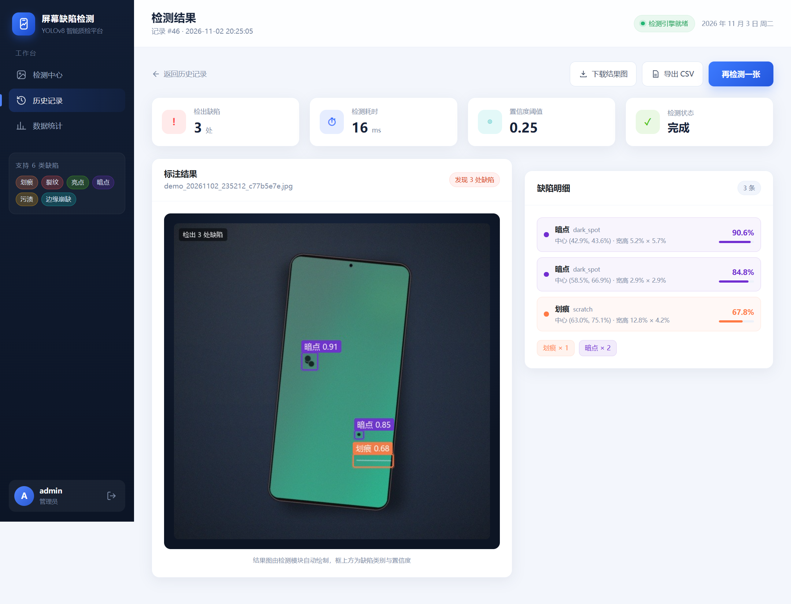

# 基于 YOLOv8 的手机屏幕外观缺陷智能检测系统

> 北邮人工智能学院 · 信息工程 · 2025219106 · 王周毅 / 林城于
>
> 课程设计第 11–14 周：可运行系统 + 训练好的模型 + 数据集构建 + 自动化测试 + 详细设计文档

一个面向手机屏幕外观质检工位的**半自动 AI 辅助检测原型**：上传屏幕照片，自动检出划痕、裂纹、亮点、暗点、污渍、边缘崩缺，给出类别、位置、置信度和 OK/NG 提示，并保存检测记录、支持历史查询和统计。

**在线站点**：https://wzy1021.github.io/phone-screen-defect-yolov8/
**在线演示**：https://wzy1021.github.io/phone-screen-defect-yolov8/demo.html
**GitHub 仓库**：https://github.com/wzy1021/phone-screen-defect-yolov8



## 在线预览

- 首页：https://wzy1021.github.io/phone-screen-defect-yolov8/
- 交互演示：https://wzy1021.github.io/phone-screen-defect-yolov8/demo.html
- 静态站源码：[`site/`](site/)；部署步骤见 [`PUBLISH.md`](PUBLISH.md)

> GitHub Pages 只能托管静态页面，跑不了 Flask + YOLOv8。在线演示里的检测结果是预生成的，不是浏览器实时推理；完整系统请在本机运行。

本地预览静态站（在仓库根目录）：

```powershell
python -m http.server 8090 --directory site
# 打开 http://127.0.0.1:8090/
```

## 功能

- 注册 / 登录 / 退出；注册账号固定为普通用户，管理员由初始化脚本创建
- 上传或拖拽屏幕照片（JPG/PNG/BMP/WEBP，≤20MB，支持多张）
- YOLOv8 检测 6 类缺陷：划痕、裂纹、亮点、暗点、污渍、边缘崩缺
- 结果图自动画框、类别 + 置信度，可下载、导出 CSV
- 历史记录：按时间、有无缺陷、用户筛选，分页、删除
- 数据统计：检测总数、缺陷总数、今日检测、平均耗时、类别柱状图/饼图、趋势
- 个人资料：昵称（2–16 位）、头像（≤2MB，自动裁 200×200）
- 管理员：用户列表、每个用户的检测次数/缺陷数、查看任意用户记录
- 屏幕区域聚焦（ROI）、亮点/暗点尺寸过滤，减少背景水花/反光误检

## 效果

| 指标 | 数值 |
|------|------|
| 原测试集 mAP50 | **0.9875** |
| 困难测试集 mAP50 | **0.8883** |
| 真实碎屏图误检 | 26 个框 → **3 个框** |
| 自动化测试 | **26/26** 通过 |
| 详细设计文档 | **52 页** |

> 指标来自合成测试集；真实场景只做过一张碎屏图的案例验证，真实产线 mAP 需要补标注数据后重新评估。详细分析见 `week11-14/详细设计说明书.docx` 第 7 章。

## 目录结构

```text
.
├── site/                       # GitHub Pages 静态展示站（纯 HTML/CSS/JS）
├── week5-6/                    # 需求分析、可行性分析
├── week7-10/                   # 概要设计
├── week11-14/                  # 实现阶段：系统、模型、数据、测试、详细设计
│   ├── app/                    # Flask 应用（接口、认证、检测、数据库）
│   ├── templates/ static/      # 页面与前端资源
│   ├── models/                 # best.pt、metrics*.json
│   ├── datasets/               # 数据生成脚本、data.yaml、统计
│   ├── datasets_hard/          # 困难版数据（微小低对比度 + 负样本）
│   ├── datasets_mix/           # 混合训练数据
│   ├── train/                  # 训练脚本与训练记录
│   ├── tests/                  # 26 个自动化测试、UI 冒烟、截图脚本
│   ├── docs/                   # 详细设计配图、测试输出、生成脚本
│   ├── screenshots/            # 系统截图
│   └── 详细设计说明书.docx
├── PUBLISH.md                  # 发布到 GitHub / GitHub Pages 的步骤
└── 项目大纲.md
```

数据集图片、训练中间产物、`data.db`、上传/结果图都在 `.gitignore` 里，不放进仓库；需要时用脚本重新生成。

## 快速开始

```powershell
cd week11-14
pip install -r requirements.txt
python run.py
# 浏览器打开 http://127.0.0.1:5000
```

本机使用 conda 环境 `diffusion-course`（已装 CUDA 版 PyTorch），也可以双击 `启动系统.bat`。

演示账号：

| 账号 | 密码 | 角色 |
|------|------|------|
| admin | 123456 | 管理员（看全部用户/记录） |
| user | 123456 | 普通用户（只看自己的记录） |

> 启动时必须用装了 `ultralytics` 的 Python 环境；用系统自带 Python 会报 `No module named 'ultralytics'`。`run.py` 启动前会自检并提示。

## 数据集与训练

```powershell
# 原版数据
python datasets/gen_dataset.py --train 1000 --val 160 --test 160

# 困难版数据（蜘蛛网裂纹、2–10 像素缺陷、水珠/反光负样本）
python datasets/gen_hard.py --train 600 --val 100 --test 100

# 混合训练（推荐用于真实低对比度照片）
python train/train_hard.py --data datasets_mix/data_mix.yaml ^
    --model train/runs_hard/hard_yolov8n/weights/best.pt ^
    --epochs 30 --name mix_yolov8n

# 只有 CPU
python train/train_hard.py --profile cpu --data datasets_mix/data_mix.yaml --epochs 30
```

更详细的说明见 [`week11-14/README.md`](week11-14/README.md)。

## 文档

- [需求分析说明书](week5-6/需求分析说明书.docx)
- [可行性分析报告](week5-6/可行性分析报告.docx)
- [概要设计说明书](week7-10/概要设计说明书.docx)
- [详细设计说明书](week11-14/详细设计说明书.docx)（52 页，含数据集、训练、模块设计、测试、低对比度改进）

## 已知边界

- 训练数据以程序化合成为主，和真实照片存在域差异；真实场景只验证了一张碎屏图。
- 摄像头孔、强反光仍可能被误判成污渍；裂纹可能只框住部分区域。
- 未做 CSRF、登录限流、SQLite 并发优化；Flask 开发服务器仅适合课程演示。
- 系统定位是“质检工位辅助检测原型”，不是完整工业级产线系统。

## 发布

见 [`PUBLISH.md`](PUBLISH.md)：`git init` → 推送到 GitHub → Settings → Pages → Source 选 GitHub Actions，工作流会自动部署 `site/`。
